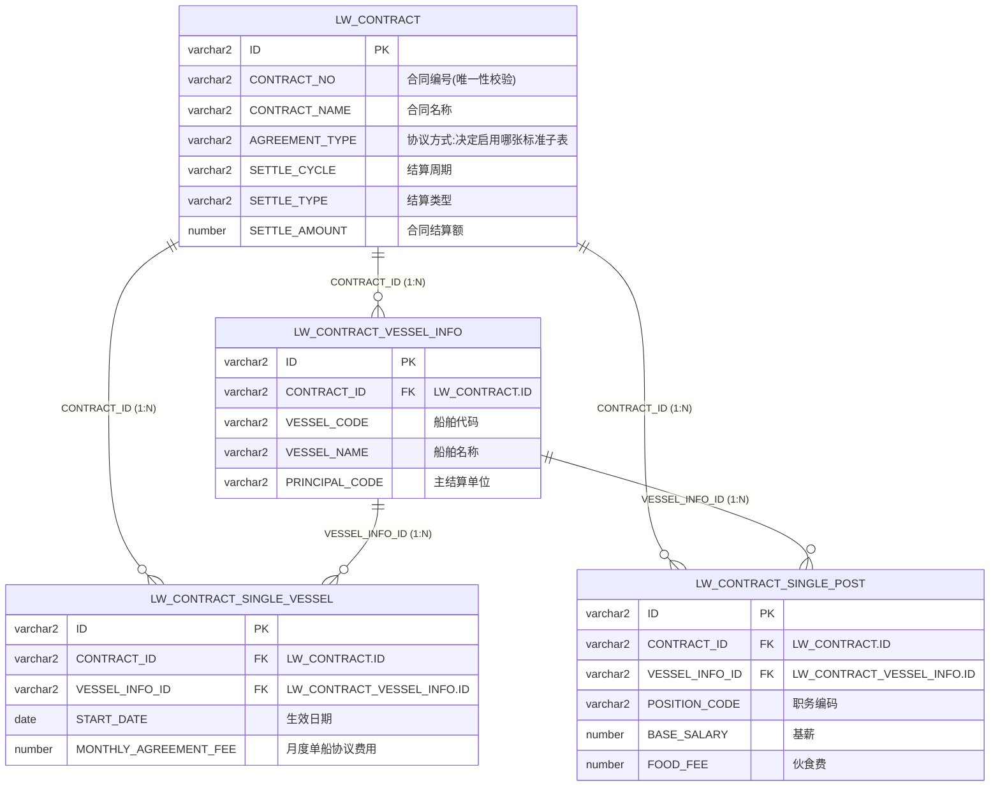

# 劳务经营合同模块（LW_CONTRACT）数据字典

> 来源：`sms-crew-server/src/main/resources/sql/lw/lw_contract_ddl.sql`（Oracle DDL）
> 金额字段统一 `NUMBER(18,2)`；是否类字段统一 `NUMBER(1)`；所有表含 BaseDomain 公共字段（OFFICE_CODE / CREATE_BY / CREATE_BY_NAME / CREATE_TIME / UPDATE_BY / UPDATE_BY_NAME / UPDATE_TIME / LOC_TIME_ZONE / IS_VOID / VERSION）。

## 表清单

| 表名 | 说明 | 主键 | 业务字段数 | 明细文档 |
|------|------|------|-----------|----------|
| LW_CONTRACT | 劳务经营合同主表 | ID | 66 | [LW_CONTRACT.md](LW_CONTRACT.md) |
| LW_CONTRACT_VESSEL_INFO | 劳务经营合同-船舶子表 | ID | 5 | [LW_CONTRACT_VESSEL_INFO.md](LW_CONTRACT_VESSEL_INFO.md) |
| LW_CONTRACT_SINGLE_VESSEL | 劳务经营合同-单船协议标准子表 | ID | 8 | [LW_CONTRACT_SINGLE_VESSEL.md](LW_CONTRACT_SINGLE_VESSEL.md) |
| LW_CONTRACT_SINGLE_POST | 劳务经营合同-单岗协议标准子表 | ID | 22 | [LW_CONTRACT_SINGLE_POST.md](LW_CONTRACT_SINGLE_POST.md) |

## 表关联关系

均为**逻辑外键**（DDL 未建物理 FK 约束），通过应用层维护，所有子表另有 `IS_VOID` 软删除配合查询。

| 主表（1） | 从表（N） | 外键字段 | 指向 | 说明 |
|-----------|-----------|----------|------|------|
| LW_CONTRACT | LW_CONTRACT_VESSEL_INFO | CONTRACT_ID | LW_CONTRACT.ID | 一个合同覆盖多艘船舶 |
| LW_CONTRACT | LW_CONTRACT_SINGLE_VESSEL | CONTRACT_ID | LW_CONTRACT.ID | 单船协议标准（冗余存储） |
| LW_CONTRACT_VESSEL_INFO | LW_CONTRACT_SINGLE_VESSEL | VESSEL_INFO_ID | LW_CONTRACT_VESSEL_INFO.ID | 标准挂在具体船舶下 |
| LW_CONTRACT | LW_CONTRACT_SINGLE_POST | CONTRACT_ID | LW_CONTRACT.ID | 单岗协议标准（冗余存储） |
| LW_CONTRACT_VESSEL_INFO | LW_CONTRACT_SINGLE_POST | VESSEL_INFO_ID | LW_CONTRACT_VESSEL_INFO.ID | 标准挂在具体船舶下 |

**业务规则**：主表 `LW_CONTRACT.AGREEMENT_TYPE`（协议方式）决定启用哪张标准子表：

- `SINGLE_VESSEL`（单船协议标准）→ 使用 `LW_CONTRACT_SINGLE_VESSEL`
- `SINGLE_POST`（单岗协议标准）→ 使用 `LW_CONTRACT_SINGLE_POST`

即两张标准子表**二选一**，结构上是并列关系，不会同时有数据。

### ER 图



### 层级结构

```
LW_CONTRACT 劳务经营合同主表 (1)
├── LW_CONTRACT_VESSEL_INFO 船舶子表 (N)          [CONTRACT_ID]
│   ├── LW_CONTRACT_SINGLE_VESSEL 单船协议标准 (N) [CONTRACT_ID + VESSEL_INFO_ID]  ← AGREEMENT_TYPE=SINGLE_VESSEL
│   └── LW_CONTRACT_SINGLE_POST 单岗协议标准 (N)   [CONTRACT_ID + VESSEL_INFO_ID]  ← AGREEMENT_TYPE=SINGLE_POST
```

### 其他说明

- 各表明细见对应 `.md` 文档；公共字段已折叠，点击展开查看。
- `LW_CONTRACT` 中签署/生效/解除/争议/终止五组日期各带 6 个审计字段（首次设置人+时间、变更人+时间），用于追踪关键日期的变更历史。
- 软删除：所有表通过 `IS_VOID=1` 作废，索引均包含 `IS_VOID` 列。
