# 劳务经营合同模块（LW_CONTRACT）数据字典

> 来源：`sms-crew-server/src/main/resources/sql/lw/lw_contract_ddl.sql` + `lw_contract_dict.sql`（Oracle DDL，2026-10-12 版）
> 金额字段统一 `NUMBER(18,2)`；是否类字段统一 `NUMBER(1)`；所有表含 BaseDomain 公共字段（OFFICE_CODE / CREATE_BY / CREATE_BY_NAME / CREATE_TIME / UPDATE_BY / UPDATE_BY_NAME / UPDATE_TIME / LOC_TIME_ZONE / IS_VOID / VERSION）。

## 表清单

| 表名 | 说明 | 主键 | 业务字段数 | 明细文档 |
|------|------|------|-----------|----------|
| `LW_CONTRACT` | 劳务经营合同主表 | ID | 58 | [LW_CONTRACT.md](LW_CONTRACT.md) |
| `LW_CONTRACT_STANDARD` | 劳务经营合同-标准子表 | ID | 6 | [LW_CONTRACT_STANDARD.md](LW_CONTRACT_STANDARD.md) |
| `LW_CONTRACT_VESSEL_INFO` | 劳务经营合同-船舶子表 | ID | 5 | [LW_CONTRACT_VESSEL_INFO.md](LW_CONTRACT_VESSEL_INFO.md) |
| `LW_CONTRACT_SINGLE_VESSEL` | 劳务经营合同-单船协议标准子表 | ID | 9 | [LW_CONTRACT_SINGLE_VESSEL.md](LW_CONTRACT_SINGLE_VESSEL.md) |
| `LW_CONTRACT_SINGLE_POST` | 劳务经营合同-单岗协议标准子表 | ID | 23 | [LW_CONTRACT_SINGLE_POST.md](LW_CONTRACT_SINGLE_POST.md) |

## 表关系

| 主表 | 子表 | 外键 | 关系 | 说明 |
|------|------|------|:----:|------|
| LW_CONTRACT | LW_CONTRACT_STANDARD | CONTRACT_ID | 1:N | 一份合同可建多条"标准"，每条标准独立命名、独立选择协议方式 |
| LW_CONTRACT | LW_CONTRACT_VESSEL_INFO | CONTRACT_ID | 1:N | 合同下的船舶信息（船舶代码、名称、主结算单位） |
| LW_CONTRACT_STANDARD | LW_CONTRACT_SINGLE_VESSEL | STANDARD_ID | 1:N | 单船协议标准明细挂在某条标准下 |
| LW_CONTRACT_STANDARD | LW_CONTRACT_SINGLE_POST | STANDARD_ID | 1:N | 单岗协议标准明细挂在某条标准下 |
| LW_CONTRACT_VESSEL_INFO | LW_CONTRACT_SINGLE_VESSEL | VESSEL_INFO_ID | 1:N | 明细冗余关联船舶子表，便于按船过滤 |
| LW_CONTRACT_VESSEL_INFO | LW_CONTRACT_SINGLE_POST | VESSEL_INFO_ID | 1:N | 明细冗余关联船舶子表，便于按船过滤 |

> 明细表（SINGLE_VESSEL / SINGLE_POST）同时冗余 CONTRACT_ID 与 VESSEL_CODE / VESSEL_NAME，均建立索引；删除走 IS_VOID 软删。

### ER 图

```mermaid
erDiagram
    LW_CONTRACT ||--o{ LW_CONTRACT_STANDARD : "CONTRACT_ID 1:N"
    LW_CONTRACT ||--o{ LW_CONTRACT_VESSEL_INFO : "CONTRACT_ID 1:N"
    LW_CONTRACT_STANDARD ||--o{ LW_CONTRACT_SINGLE_VESSEL : "STANDARD_ID 1:N"
    LW_CONTRACT_STANDARD ||--o{ LW_CONTRACT_SINGLE_POST : "STANDARD_ID 1:N"
    LW_CONTRACT_VESSEL_INFO ||--o{ LW_CONTRACT_SINGLE_VESSEL : "VESSEL_INFO_ID 1:N"
    LW_CONTRACT_VESSEL_INFO ||--o{ LW_CONTRACT_SINGLE_POST : "VESSEL_INFO_ID 1:N"
    LW_CONTRACT { string ID PK }
    LW_CONTRACT_STANDARD { string ID PK }
    LW_CONTRACT_STANDARD { string CONTRACT_ID FK }
    LW_CONTRACT_STANDARD { string AGREEMENT_TYPE }
    LW_CONTRACT_VESSEL_INFO { string ID PK }
    LW_CONTRACT_VESSEL_INFO { string CONTRACT_ID FK }
    LW_CONTRACT_SINGLE_VESSEL { string ID PK }
    LW_CONTRACT_SINGLE_VESSEL { string CONTRACT_ID FK }
    LW_CONTRACT_SINGLE_VESSEL { string STANDARD_ID FK }
    LW_CONTRACT_SINGLE_VESSEL { string VESSEL_INFO_ID FK }
    LW_CONTRACT_SINGLE_POST { string ID PK }
    LW_CONTRACT_SINGLE_POST { string CONTRACT_ID FK }
    LW_CONTRACT_SINGLE_POST { string STANDARD_ID FK }
    LW_CONTRACT_SINGLE_POST { string VESSEL_INFO_ID FK }
```



### 层级结构

```
LW_CONTRACT 劳务经营合同主表
├── LW_CONTRACT_STANDARD 标准子表（一合同多标准，每标准独立协议方式）
│   ├── LW_CONTRACT_SINGLE_VESSEL 单船协议标准明细（协议方式=单船时）
│   └── LW_CONTRACT_SINGLE_POST   单岗协议标准明细（协议方式=单岗时）
└── LW_CONTRACT_VESSEL_INFO 船舶子表（合同适用船舶）
    ├── ← SINGLE_VESSEL.VESSEL_INFO_ID
    └── ← SINGLE_POST.VESSEL_INFO_ID
```

## 业务要点

- **标准方案表（本次新增）**：`AGREEMENT_TYPE` 协议方式由主表下沉到 `LW_CONTRACT_STANDARD`，一份合同可挂多条标准；`SINGLE_VESSEL`-单船协议标准（费用走 `LW_CONTRACT_SINGLE_VESSEL.MONTHLY_AGREEMENT_FEE` 月度单船协议费用），`SINGLE_POST`-单岗协议标准（费用走 `LW_CONTRACT_SINGLE_POST` 各费用项，与字典 `LW_HK_PROJECT` 编码一一对应）。
- **香港公司项目**：`LW_CONTRACT_STANDARD.HK_PROJECT_CODES` 存字典 `LW_HK_PROJECT` 编码，多个以英文逗号分隔。
- **结算类型**：主表 `SETTLE_TYPE`（FIXED_30-月固定天数(30) / ACTUAL-月实际天数），字典 `LW_SETTLE_TYPE`。
- **关键日期审计**：主表对 签署(SIGNED_)/生效(EFFICIENT_)/解除(LIFTED_)/争议(DISPUTE_)/终止(TERMINATION_) 五类日期分别记录 首次设置(CREATE_*) 与 变更(UPDATE_*) 的人与时间。
- **软删与乐观锁**：所有表 `IS_VOID`（0-否 1-是）软删除，`VERSION` 乐观锁版本号。

## 字典（lw_contract_dict.sql）

### LW_SETTLE_TYPE 结算类型

| 编码 | 名称 | 排序 |
|------|------|:--:|
| FIXED_30 | 月固定天数（30） | 1 |
| ACTUAL | 月实际天数 | 2 |

### LW_AGREEMENT_TYPE 协议方式

| 编码 | 名称 | 排序 |
|------|------|:--:|
| SINGLE_VESSEL | 单船协议标准 | 1 |
| SINGLE_POST | 单岗协议标准 | 2 |

### LW_HK_PROJECT 香港公司项目(费用项)

| 编码 | 名称 | 排序 |
|------|------|:--:|
| BASE_SALARY | 基薪 | 1 |
| TRAVEL_SALARY | 路途薪 | 2 |
| LEAVE_ASSESS_BONUS | 离船考核奖 | 3 |
| OVERDUE_SUBSIDY | 超期补贴 | 4 |
| SUPPLIER_RETURN_BONUS | 供方老手返船奖 | 5 |
| AGENCY_FEE | 代理费 | 6 |
| MANAGEMENT_FEE | 管理费 | 7 |
| ASSEMBLY_FEE | 集结包干费 | 8 |
| UNIFORM_FEE | 制服费 | 9 |
| TRAINING_FEE | 培训费 | 10 |
| FOOD_FEE | 伙食费 | 11 |

### 引用的系统外部字典

| 字典 | 使用位置 |
|------|---------|
| CONTRACT_CHARACTER | LW_CONTRACT.CONTRACT_CHARACTER（合同性质） |
| CONTRACT_TEXT_TYPE | LW_CONTRACT.CONTRACT_TEXT_TYPE（合同文本类型） |
| CTS_SETTLEMENT_BLOCK | LW_CONTRACT.SEAMAN_DB_BLOCK（板块） |
| CURRENCY | LW_CONTRACT 币种字段 |
| EXTENSION_CLAUSE | LW_CONTRACT.EXTENSION_CLAUSE（延期条款） |
