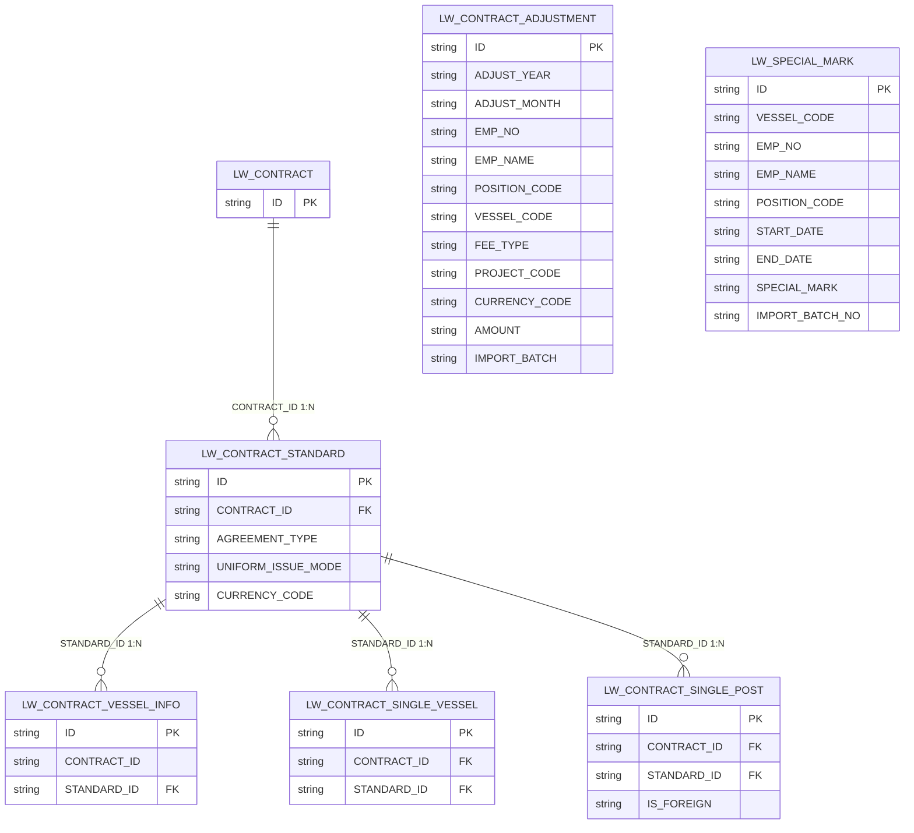

# 劳务经营合同模块（LW_CONTRACT）数据字典

> 来源：`sms-crew-server/src/main/resources/sql/lw/` 下 `lw_contract_ddl.sql` + `lw_contract_dict.sql` + `lw_contract_adjustment.sql` + `lw_special_mark.sql`（Oracle DDL，2026-10-26 版：单船/单岗明细改为标准级共用，不再冗余船舶字段）
> 金额字段统一 `NUMBER(18,2)`；是否类字段统一 `NUMBER(1)`；所有表含 BaseDomain 公共字段（OFFICE_CODE / CREATE_BY / CREATE_BY_NAME / CREATE_TIME / UPDATE_BY / UPDATE_BY_NAME / UPDATE_TIME / LOC_TIME_ZONE / IS_VOID / VERSION）。

## 表清单

| 表名 | 说明 | 主键 | 业务字段数 | 明细文档 |
|------|------|------|-----------|----------|
| `LW_CONTRACT` | 劳务经营合同主表 | ID | 57 | [LW_CONTRACT.md](LW_CONTRACT.md) |
| `LW_CONTRACT_STANDARD` | 劳务经营合同-标准子表 | ID | 8 | [LW_CONTRACT_STANDARD.md](LW_CONTRACT_STANDARD.md) |
| `LW_CONTRACT_VESSEL_INFO` | 劳务经营合同-船舶子表(挂标准下，标准与船舶一对多) | ID | 6 | [LW_CONTRACT_VESSEL_INFO.md](LW_CONTRACT_VESSEL_INFO.md) |
| `LW_CONTRACT_SINGLE_VESSEL` | 劳务经营合同-单船协议标准子表 | ID | 6 | [LW_CONTRACT_SINGLE_VESSEL.md](LW_CONTRACT_SINGLE_VESSEL.md) |
| `LW_CONTRACT_SINGLE_POST` | 劳务经营合同-单岗协议标准子表 | ID | 19 | [LW_CONTRACT_SINGLE_POST.md](LW_CONTRACT_SINGLE_POST.md) |
| `LW_CONTRACT_ADJUSTMENT` | 调补维护（无固定核算标准的费用手工录入） | ID | 13 | [LW_CONTRACT_ADJUSTMENT.md](LW_CONTRACT_ADJUSTMENT.md) |
| `LW_SPECIAL_MARK` | 船员特殊标记（特殊维护页面） | ID | 10 | [LW_SPECIAL_MARK.md](LW_SPECIAL_MARK.md) |

## 表关系

| 主表 | 子表 | 外键 | 关系 | 说明 |
|------|------|------|:----:|------|
| LW_CONTRACT | LW_CONTRACT_STANDARD | CONTRACT_ID | 1:N | 一份合同可建多条"标准"，每条标准独立命名、独立选择协议方式/币种/制服费发放方式 |
| LW_CONTRACT_STANDARD | LW_CONTRACT_VESSEL_INFO | STANDARD_ID | 1:N | 船舶挂在标准下，标准与船舶一对多（同一船舶跨标准不重叠）；CONTRACT_ID 为冗余字段 |
| LW_CONTRACT_STANDARD | LW_CONTRACT_SINGLE_VESSEL | STANDARD_ID | 1:N | 单船协议标准明细挂在某条标准下 |
| LW_CONTRACT_STANDARD | LW_CONTRACT_SINGLE_POST | STANDARD_ID | 1:N | 单岗协议标准明细挂在某条标准下 |
| LW_CONTRACT_VESSEL_INFO | LW_CONTRACT_SINGLE_VESSEL | - | - | 2026-10-26 起明细为标准级共用，不再关联船舶子表 |
| LW_CONTRACT_VESSEL_INFO | LW_CONTRACT_SINGLE_POST | - | - | 2026-10-26 起明细为标准级共用，不再关联船舶子表 |

> 明细表（SINGLE_VESSEL / SINGLE_POST）冗余 `CONTRACT_ID`（2026-10-26 起移除 `VESSEL_INFO_ID` / `VESSEL_CODE` / `VESSEL_NAME` 及对应索引，同一标准下多艘船舶共用一套明细）；删除走 IS_VOID 软删。

### 独立维护表（无合同外键）

| 表 | 说明 | 关联方式 |
|----|------|---------|
| `LW_CONTRACT_ADJUSTMENT` | 调补维护（2026-10-16 改版重建）：无固定核算标准的费用手工/导入录入，一行一笔金额+年/月+项目 | 按船代码 / 工号关联船舶、船员主数据 |
| `LW_SPECIAL_MARK` | 船员特殊标记：按船按人维护起止日期内的特殊标记 | 按船代码 / 工号关联船舶、船员主数据 |

### ER 图



### 层级结构

```
LW_CONTRACT 劳务经营合同主表
└── LW_CONTRACT_STANDARD 标准子表（一合同多标准，每标准独立协议方式/币种/制服费发放方式）
    ├── LW_CONTRACT_VESSEL_INFO     船舶子表（标准与船舶一对多，同一船舶跨标准不重叠）
    ├── LW_CONTRACT_SINGLE_VESSEL   单船协议标准明细（协议方式=单船时，标准级共用：标准下多艘船舶共用一套明细）
    └── LW_CONTRACT_SINGLE_POST     单岗协议标准明细（协议方式=单岗时，标准级共用：标准下多艘船舶共用一套明细）

独立维护表（不挂合同外键）：
├── LW_CONTRACT_ADJUSTMENT 调补维护（一行一笔金额+年/月+项目，手工/导入维护）
└── LW_SPECIAL_MARK 船员特殊标记（按船按人维护起止日期内标记，手工/导入维护）
```

## 业务要点

- **标准方案表**：`AGREEMENT_TYPE` 协议方式由主表下沉到 `LW_CONTRACT_STANDARD`，一份合同可挂多条标准，每条标准独立命名、独立选择协议方式；`SINGLE_VESSEL`-单船协议标准（费用走 `LW_CONTRACT_SINGLE_VESSEL.MONTHLY_AGREEMENT_FEE` 月度单船协议费用），`SINGLE_POST`-单岗协议标准（费用走 `LW_CONTRACT_SINGLE_POST` 各费用项，与字典 `LW_HK_PROJECT` 编码对应）。
- **标准币种与制服费发放方式（2026-10-14 新增）**：`LW_CONTRACT_STANDARD.CURRENCY_CODE` 标准币种（字典 `CURRENCY`，前端必输）；`UNIFORM_ISSUE_MODE` 制服费发放方式（字典 `LW_UNIFORM_ISSUE_MODE`： ONBOARD-上船发放 OFFBOARD-下船发放，前端必输）。
- **标准与船舶一对多（2026-10-15 调整）**：船舶信息挂到标准下（`VESSEL_INFO.STANDARD_ID`），一条标准可配多条船舶，同一船舶跨标准不重叠；`CONTRACT_ID` 保留为冗余字段。主表已移除板块字段 `SEAMAN_DB_BLOCK`，单岗明细已移除超期补贴字段 `OVERDUE_SUBSIDY`（字典 `LW_HK_PROJECT` 暂保留该项）。
- **明细表标准级共用（2026-10-26 调整）**：`LW_CONTRACT_SINGLE_VESSEL` / `LW_CONTRACT_SINGLE_POST` 移除 `VESSEL_INFO_ID` / `VESSEL_CODE` / `VESSEL_NAME` 列及 `IDX_LW_CSV_INFO` / `IDX_LW_CSP_INFO` 索引，明细直接挂标准（`STANDARD_ID`），同一标准下多艘船舶共用同一套明细；单岗明细同标准内按 `生效日期 + 职务 + 是否外籍（IS_FOREIGN）` 唯一。
- **香港公司项目**：`LW_CONTRACT_STANDARD.HK_PROJECT_CODES` 存字典 `LW_HK_PROJECT` 编码，多个以英文逗号分隔。
- **结算类型**：主表 `SETTLE_TYPE`（FIXED_30-月固定天数(30) / ACTUAL-月实际天数），字典 `LW_SETTLE_TYPE`。
- **关键日期审计**：主表对 签署(SIGNED_)/生效(EFFICIENT_)/解除(LIFTED_)/争议(DISPUTE_)/终止(TERMINATION_) 五类日期分别记录 首次设置(CREATE_*) 与 变更(UPDATE_*) 的人与时间。
- **调补维护（LW_CONTRACT_ADJUSTMENT，2026-10-16 改版重建）**：无固定核算标准的费用手工/导入录入；由「一行 9 个金额列」改为「一行一笔金额 + 年/月 + 项目」；`FEE_TYPE` 字典 `LW_ADJUST_FEE_TYPE`（1-调补项目→`PROJECT_CODE` 取 `LW_APPOINT_TO`，2-其他项目→取 `LW_OTHER`，按 FEE_TYPE 联动）；`AMOUNT` 金额、`CURRENCY_CODE` 币种（字典 `CURRENCY`）；`IMPORT_BATCH` 导入批次号（yyyyMMddHHmmss），支持按批次批量删除。
- **船员特殊标记（LW_SPECIAL_MARK，2026-10-16 新增）**：按船代码+工号维护起止日期（`END_DATE` 为空表示长期有效）内的 `SPECIAL_MARK`，字典 `BUSINESS_CONTRACT_MARK`（1-船东派员/2-出入境/3-船员重叠/4-增岗/5-减岗）；`IMPORT_BATCH_NO` 导入批次号支持批量删除。
- **软删与乐观锁**：所有表 `IS_VOID`（0-否 1-是）软删除，`VERSION` 乐观锁版本号。

## 字典（lw_contract_dict.sql + lw_contract_adjustment.sql）

### LW_SETTLE_TYPE 结算类型

| 编码 | 名称 | 排序 |
|------|------|:--:|
| FIXED_30 | 月固定天数（30） | 1 |
| ACTUAL | 月实际天数 | 2 |

### LW_AGREEMENT_TYPE 协议方式

| 编码 | 名称 | 排序 |
|------|------|:--:|
| SINGLE_VESSEL | 单船协议标准 | 1 |
| SINGLE_POST | 单岗协议标准 | 2 |

### LW_UNIFORM_ISSUE_MODE 制服费发放方式

| 编码 | 名称 | 排序 |
|------|------|:--:|
| ONBOARD | 上船发放 | 1 |
| OFFBOARD | 下船发放 | 2 |

### LW_HK_PROJECT 香港公司项目(费用项)

| 编码 | 名称 | 排序 |
|------|------|:--:|
| BASE_SALARY | 基薪 | 1 |
| TRAVEL_SALARY | 路途薪 | 2 |
| LEAVE_ASSESS_BONUS | 离船考核奖 | 3 |
| OVERDUE_SUBSIDY | 超期补贴 | 4 |
| SUPPLIER_RETURN_BONUS | 供方老手返船奖 | 5 |
| AGENCY_FEE | 代理费 | 6 |
| MANAGEMENT_FEE | 管理费 | 7 |
| ASSEMBLY_FEE | 集结包干费 | 8 |
| UNIFORM_FEE | 制服费 | 9 |
| TRAINING_FEE | 培训费 | 10 |
| FOOD_FEE | 伙食费 | 11 |

### BUSINESS_CONTRACT_MARK 业务合同特殊标记

| 编码 | 名称 | 排序 |
|------|------|:--:|
| 1 | 船东派员 | 1 |
| 2 | 出入境 | 2 |
| 3 | 重叠船员 | 3 |
| 4 | 增岗 | 4 |
| 5 | 减岗 | 5 |

### LW_ADJUST_FEE_TYPE 协议费用项目(调补费用类型)

| 编码 | 名称 | 排序 |
|------|------|:--:|
| 1 | 调补项目 | 1 |
| 2 | 其他项目 | 2 |

### LW_APPOINT_TO 项目-指定给(调补项目费用项)

| 编码 | 名称 | 排序 |
|------|------|:--:|
| BASE_SALARY | 基薪 | 1 |
| TRAVEL_SALARY | 路途薪 | 2 |
| LEAVE_ASSESS_BONUS | 离船考核奖 | 3 |
| AGENCY_FEE | 代理费 | 4 |
| MANAGEMENT_FEE | 管理费 | 5 |
| ASSEMBLY_FEE | 集结包干费 | 6 |
| UNIFORM_FEE | 制服费 | 7 |
| TRAINING_FEE | 培训费 | 8 |
| OVERDUE_SUBSIDY | 超期补贴 | 9 |
| GF_RETURN_BONUS | 供方老手返船奖 | 10 |
| FOOD_FEE | 伙食费 | 11 |

### LW_OTHER 项目-其他项目费用项

| 编码 | 名称 | 排序 |
|------|------|:--:|
| WAITING_WAGE | 候船工资 | 1 |
| LABOR_FEE | 劳务费 | 2 |
| CREW_INSUR_CLAIM | 船员保赔款 | 3 |
| CERT_EXPENSES | 外籍证书费 | 4 |
| VISA_FEE | 签证费 | 5 |
| ADVANCE_FEE | 代垫款 | 6 |
| SHIP_OWNER_DEDUCTION | 船东扣款 | 7 |
| ACCIDENT_INSURE | 意外险 | 8 |
| AGREEMENT_FEE_DIFF | 协议费用补差 | 9 |

### 引用的系统外部字典

| 字典 | 使用位置 |
|------|---------|
| BUSINESS_CONTRACT_MARK | LW_SPECIAL_MARK.SPECIAL_MARK（特殊标记） |
| CONTRACT_CHARACTER | LW_CONTRACT.CONTRACT_CHARACTER（合同性质） |
| CONTRACT_TEXT_TYPE | LW_CONTRACT.CONTRACT_TEXT_TYPE（合同文本类型） |
| CURRENCY | LW_CONTRACT / LW_CONTRACT_STANDARD / LW_CONTRACT_ADJUSTMENT 币种字段 |
| EXTENSION_CLAUSE | LW_CONTRACT.EXTENSION_CLAUSE（延期条款） |
